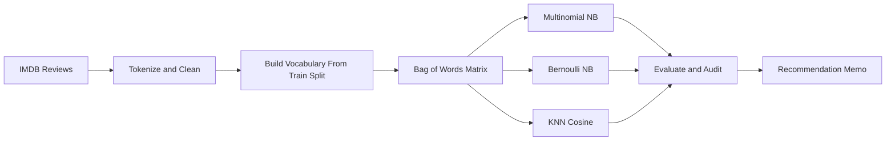

<div align="center">

<!-- Animated header banner -->


<br/>


</div>

---

## Table of Contents

- [Student Information](#student-information)
- [About This Assignment](#about-this-assignment)
- [Repository Structure](#repository-structure)
- [Question 1, Austin Animal Center](#question-1-austin-animal-center)
- [Question 2, CineTrust Review Audit](#question-2-cinetrust-review-audit)
- [Model Architecture Overview](#model-architecture-overview)
- [How to Run the Notebooks](#how-to-run-the-notebooks)
- [Assignment Rules Followed](#assignment-rules-followed)

---

## Student Information

| Field | Details |
|---|---|
| **Name** | Abdul Azeem Hashmi |
| **Roll Number** | 24I-2013 |
| **Section** | BAI-5A |
| **Course** | Machine Learning |
| **Due Date** | October 11, 2026 |
| **Total Marks** | 135 base marks plus 8 bonus marks |

---

## About This Assignment

This assignment has two questions. Both ask for classifiers built from scratch, so the core models do not use any machine learning library.

**Question 1** builds a mixed Bayesian classifier that predicts what happens to an animal at a shelter. It combines categorical features with Laplace smoothing and numeric features with a Gaussian likelihood. Question 1 is worth 20 marks.

**Question 2** audits a Naive Bayes review system for a made up company called CineTrust Analytics. It builds two Naive Bayes variants and a KNN classifier, tests them with hard examples, and ends with a written recommendation. Question 2 is worth 115 marks plus 8 bonus marks.

<div align="center">

</div>

---

## Repository Structure

This matches the files in the repository.

```
bayesian-and-knn-classifiers/
├── 24i-2013_AbdulAzeem_BAI-5A_Notebook1.ipynb   # Question 1 notebook
├── 24i-2013_AbdulAzeem_BAI-5A_Question2.ipynb   # Question 2 notebook
├── 24i-2013_AbdulAzeem_BAI-5A_Report.pdf        # Question 1 report (2 pages)
├── Assignment1.pdf                              # Original assignment brief
├── aac_intakes_outcomes.csv                     # Dataset for Question 1
├── dataset Question2/                           # Dataset for Question 2
│   ├── imdb1/
│   │   ├── pos/                                 # 1,000 positive review files
│   │   └── neg/                                 # 1,000 negative review files
│   └── english.stop                             # English stopword list
└── readme.md                                    # This file
```

---

## Question 1, Austin Animal Center

**File:** `24i-2013_AbdulAzeem_BAI-5A_Notebook1.ipynb`
**Report:** `24i-2013_AbdulAzeem_BAI-5A_Report.pdf`

The goal is to predict the outcome of a shelter animal using only information known at intake. The classifier is written with `numpy`, `math`, `csv`, and `os` only.

### Dataset

| Item | Value |
|---|---|
| Source | Austin Animal Center intakes and outcomes |
| Total records parsed | 79,672 |
| Train split | 63,737 |
| Test split | 15,935 |
| Split type | Stratified 80/20 |

### Four Outcome Classes

| Class | Meaning | Train Count | Prior |
|---|---|---|---|
| Adoption | Adopted by a person | 26,875 | 0.4217 |
| Transfer | Moved to another shelter | 19,039 | 0.2987 |
| Return_to_Owner | Returned to its owner | 11,833 | 0.1857 |
| Other | Euthanasia, died, missing, and so on | 5,990 | 0.0940 |

### Features

| Feature | Type | Encoding |
|---|---|---|
| Animal Type | Categorical | Dog = 1, Cat = 0, other = 0 |
| Sex Upon Intake | Categorical | Neutered or Spayed = 2, Intact = 1, other = 0 |
| Color | Categorical | First word of the color text, uppercase |
| Breed | Categorical | Top 20 breeds from the training set, everything else is "Other" |
| Age in days | Numeric (Gaussian) | Parsed from text such as "2 years", then z-scored |
| Time in shelter | Numeric (Gaussian) | Outcome date minus intake date in days, then z-scored |

### Settings Taken From the Roll Number 24I-2013

| Setting | Formula | Value |
|---|---|---|
| Random seed | (242013 mod 97) + 7 | 102 |
| Laplace smoothing K | 0.5 + (digit sum mod 5) / 10 | 0.70 |
| Worked example test row | 242013 mod 97 | 95 |

### Results

| Metric | Value |
|---|---|
| Overall accuracy | 55.23% |
| Macro F1 | 0.5629 |

| Class | Precision | Recall | F1 |
|---|---|---|---|
| Adoption | 0.6124 | 0.5156 | 0.5598 |
| Transfer | 0.5037 | 0.5821 | 0.5401 |
| Return_to_Owner | 0.4671 | 0.6288 | 0.5360 |
| Other | 0.8869 | 0.4713 | 0.6155 |

**Confusion matrix** (rows are actual, columns are predicted):

| Actual \ Predicted | Adoption | Transfer | Return | Other |
|---|---:|---:|---:|---:|
| Adoption | 3,464 | 2,006 | 1,226 | 23 |
| Transfer | 1,243 | 2,771 | 691 | 55 |
| Return_to_Owner | 779 | 307 | 1,860 | 12 |
| Other | 170 | 417 | 205 | 706 |

### What the Results Show

- **Other has very high precision (0.8869).** Wildlife such as bats and raccoons shows up in the top breeds and is never adopted or transferred, so the model finds this class easily when it predicts it.
- **Other has low recall (0.4713).** Many Other animals are predicted as Adoption, Transfer, or Return.
- **Breed and animal type overlap.** A breed such as Pit Bull already implies a dog, which breaks the independence assumption of Naive Bayes.
- **Stay length is not Gaussian.** Time in shelter has sharp peaks near zero days, so a Gaussian is only a rough fit.

The report PDF also includes a worked example for test row 95 (a black, intact Domestic Shorthair Mix cat). Its true outcome was Transfer, and the model predicted Transfer with a posterior of 0.7837.

---

## Question 2, CineTrust Review Audit

**File:** `24i-2013_AbdulAzeem_BAI-5A_Question2.ipynb`

The goal is to audit a Naive Bayes sentiment classifier on the IMDB movie review dataset. The notebook is organized into Parts A to G. Scikit-learn is imported only in Part G.

### Dataset

| Item | Value |
|---|---|
| Total reviews | 2,000 (1,000 positive and 1,000 negative) |
| Review length | Mean 746.3 words, median 696.5, min 17, max 2,678 |
| Split | Train 1,400, validation 300, test 300 |
| Random seed | 102 |
| Raw training vocabulary | 33,297 words |
| Filtered vocabulary (min_df of 3 or more) | 14,827 words |
| Feature space reduction | 55.5% |

### Parts Covered

| Part | Topic | Marks |
|---|---|---|
| A | Bayes theorem derivation, hand worked toy example, log space reasoning | 15 |
| B | Preprocessing, MultinomialNB and BernoulliNB from scratch | 25 |
| C | Smoothing sweep, out of vocabulary test, prior shift | 18 |
| D | Calibration and overconfidence | 14 |
| E | Negation, sarcasm, and correlated word failures, plus bonus fix | 13 + 8 bonus |
| F | KNN from scratch with cosine distance | 15 |
| G | Scikit-learn sanity check and recommendation memo | 15 |

### Model Comparison on the Test Set

All numbers below come from the executed notebook.

| Model | Accuracy | Precision | Recall | F1 |
|---|---:|---:|---:|---:|
| Multinomial Naive Bayes | 80.67% | 0.8286 | 0.7733 | 0.8000 |
| Bernoulli Naive Bayes | 81.33% | 0.8730 | 0.7333 | 0.7971 |
| KNN (k = 31, cosine) | 69.33% | 0.7302 | 0.6133 | 0.6667 |

The scikit-learn versions of all three models give the same accuracy and F1, with a 0.00% gap, which confirms the from scratch code is correct.

### Speed Comparison

| Model | Time per review | Reviews per second | Complexity |
|---|---:|---:|---|
| Multinomial Naive Bayes | 0.1023 ms | 9,773 | O(words in review) |
| KNN (k = 31) | 0.8925 ms | 1,120 | O(training reviews x vocabulary) |

KNN is about 8.7 times slower than Multinomial Naive Bayes in this run.

### Key Findings

1. **Smoothing is needed.** In the out of vocabulary test with 10 reviews, 8 of them gave a likelihood of negative infinity for both classes when smoothing was off. Only 2 could still be scored. With smoothing on, all 10 were classified correctly.
2. **Smoothing sweep.** Validation accuracy rose from 75.67% at k = 0.01 to 79.33% at k = 5. Test accuracy stayed between 80.33% and 81.67%.
3. **A different class prior flips a few predictions.** Changing the positive prior from 50% to 68% flipped 3 of 300 test predictions (1.00%). All 3 moved from negative to positive.
4. **The probabilities are overconfident.** 283 of 300 test reviews (94.33%) fall in the top confidence bin, with a mean confidence of 0.9976. The observed accuracy in that bin is only 83.75%.
5. **Hard sentences expose bag of words limits.** On 8 hand written sentences (3 negation, 3 sarcasm, 2 compositional), Multinomial Naive Bayes got 5 right and 3 wrong. Bernoulli Naive Bayes predicted negative for all 8 with 100% confidence.
6. **The negation tagging bonus gave no change.** Tagging words after "not" as `NOT_word` grew the vocabulary to 22,450 features, but all 8 test sentences kept the same correct or wrong status.
7. **KNN underperformed.** The best k on the validation split was 31 (70.33% validation accuracy), and its test accuracy of 69.33% is about 11 points below the Naive Bayes models.

### KNN Validation Sweep

| k | 1 | 3 | 5 | 15 | 31 |
|---|---:|---:|---:|---:|---:|
| Validation accuracy | 68.33% | 65.33% | 67.67% | 68.00% | 70.33% |

---

## Model Architecture Overview

```
QUESTION 1: MIXED BAYESIAN CLASSIFIER
=====================================

          Input Features
               |
     +---------+---------+
     |                   |
  Categorical          Numeric
  Features             Features
  (AnimalType,         (age_days,
   SexUponIntake,       time_in_shelter)
   Color, Breed)              |
     |                  Z-score scaling
  Laplace smoothing           |
  with K = 0.70        Gaussian fit
     |                 (mean, variance)
  Categorical NB              |
     |                        |
     +----------+-------------+
                |
         Log posterior
         (log prior + sum of log likelihoods)
                |
         Log-sum-exp normalization
                |
         argmax gives the predicted class


QUESTION 2: TEXT SENTIMENT CLASSIFIERS
======================================

   Raw review text
         |
    Preprocessing
    (lowercase, keep words of 2+ letters,
     remove stopwords, keep negation words)
         |
    Bag of words vectors
    (14,827 word vocabulary)
         |
    +----------+----------+
    |          |          |
 Multinomial Bernoulli   KNN
 NB          NB          (k = 31, cosine)
 (counts)    (presence)
    |          |          |
    +----------+----------+
               |
    Accuracy, F1, confusion matrix,
    calibration, speed
```

<div align="center">



</div>

---

## How to Run the Notebooks

**Requirements**

```
Python 3.12 or newer
numpy
pandas
matplotlib
scikit-learn
jupyter
```

**Install**

```bash
pip install numpy pandas matplotlib scikit-learn jupyter
```

**Run Question 1**

```bash
jupyter notebook 24i-2013_AbdulAzeem_BAI-5A_Notebook1.ipynb
```

Keep `aac_intakes_outcomes.csv` in the same folder as the notebook. Notebook 1 only needs numpy.

**Run Question 2**

```bash
jupyter notebook 24i-2013_AbdulAzeem_BAI-5A_Question2.ipynb
```

Keep the `dataset Question2` folder in the same folder as the notebook. The notebook reads `dataset Question2/imdb1/pos`, `dataset Question2/imdb1/neg`, and `dataset Question2/english.stop`.

---

## Assignment Rules Followed

- This is an individual assignment, so there was no group work.
- The core Bayesian, Naive Bayes, and KNN models are written from scratch.
- Notebook 1 imports only `numpy`, `math`, `csv`, and `os`.
- In Notebook 2, scikit-learn is used only in Part G as a labeled sanity check.
- No pre-trained sentiment tools or language models are used.
- Both notebooks have all cells executed with outputs and plots visible.
- A fixed random seed of 102 is used for both questions.
- Files follow the naming format `24i-2013_AbdulAzeem_BAI-5A`.

---

<div align="center">


</div>